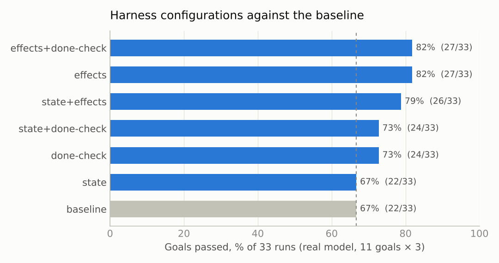
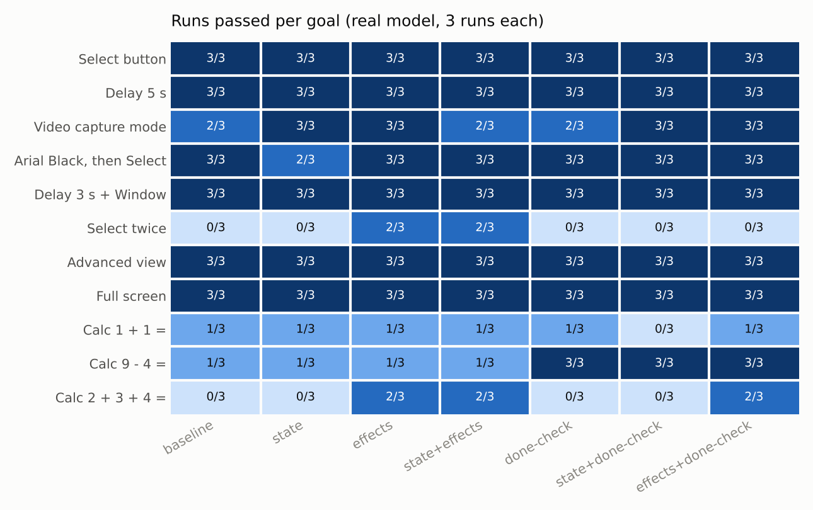
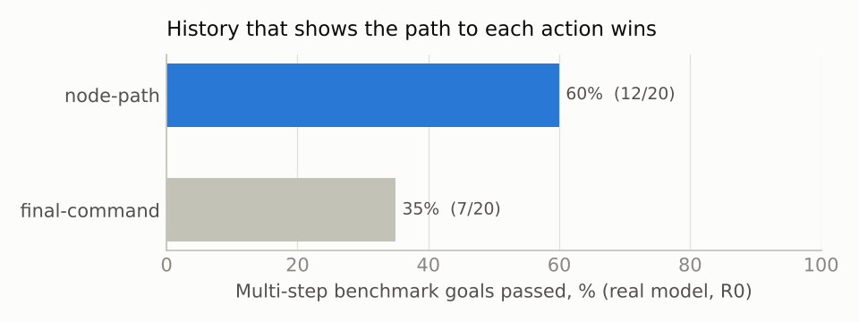
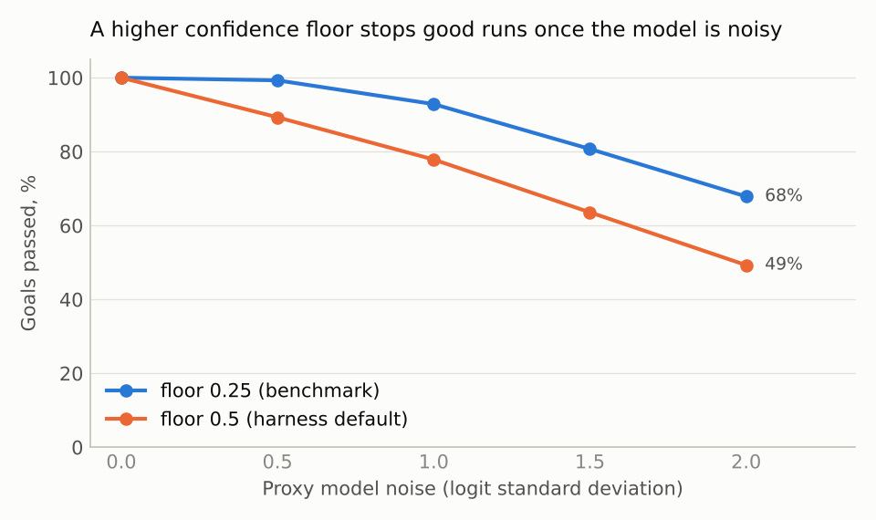

# Harness experiments

What we tested on the system-one harness, what worked, and the numbers behind it. Every run is a row in [`experiments.csv`](experiments.csv). Details and raw logs are in [`sim/README.md`](sim/README.md) and `sim/results*.txt`.

## In short

- **Turn on `SHOW_EFFECTS`.** Writing what each action changed into the history ("Capture mode (off) -> (on)") is the only change that clearly beats the baseline: **27/33 against 22/33**, with fewer model calls.
- **Node-path history beats final-command history** (12/20 against 7/20 on multi-step goals). The old mode has been removed.
- **Keep the confidence floor at 0.25.** The harness default of 0.5 loses 10–19 points once the model makes mistakes.
- **Don't adopt** `SHOW_STATE`, the reworded `INSTRUCTIONS`, or `RESUME`. They tied or lost.
- **`DONE_CHECK` is a trade-off.** It fixes early quits on Calculator but judges "Select twice" done after one click. Combined with effects it ties effects alone (27/33) at a higher cost.



## How we tested

`benchmark.py` needs Windows UI Automation and the real apps, which a Linux cloud container doesn't have. So `sim/` runs the same harness code, unchanged, against simulated apps:

| Part | What it is |
|---|---|
| Desktop | Simulated UIA trees for Character Map, Snipping Tool and Calculator, with Edge, File Explorer, the taskbar and Program Manager as distractors. Actions change state: a pick closes its dropdown, Close removes the window, Calculator computes. |
| Real model | OpenJev-Flash-9B Q4_K_M in a local Ollama, CPU only, 5–10 s per decision. |
| Proxy model | A word-matching stand-in with tunable noise, for fast, repeatable runs. It ignores wording and state, so it can't judge prompt changes. |
| Goals | `benchmark.py`'s 7 goals plus 4 extra: Advanced view, Full screen, 9 - 4 =, 2 + 3 + 4 =. Wingdings is a fifth extra that no configuration can reach (it's scrolled out of view). It's in the proxy runs and R0 only. |
| Scoring | A run passes if its actions happened in order **and** the screen shows the result: the toggle is on, the right item is picked, Select was clicked the right number of times, or Calculator shows the answer. R0 used `benchmark.py`'s action-text scoring, which passes a toggle pressed twice. |
| Settings | `benchmark.py`'s: confidence floor 0.25, at most 10 actions. Paired seeds, so every configuration sees the same option order. |

Three runs per goal is a small sample: one-run differences are noise. Results that held in every run are called out below.

## Experiment log

| # | Experiment | Model | Runs | Result |
|---|---|---|---|---|
| P0 | Final-command vs node-path history, noise sweep (earlier code, not in the CSV) | Proxy | 60 per goal | Node path 194/240 on multi-step goals, final command 148/240 |
| R0 | Final-command vs node-path history | Real | 120 | Node path 12/20 on multi-step goals, final command 7/20 |
| R1 | `state`, `instructions`, `resume` against the baseline | Real | 132 | Baseline 22/33. state 22/33, instructions 19/33, resume 13/33 |
| R2 | `effects` and `done-check`, each alone and with `state` | Real | 198 | effects 27/33, state+effects 26/33, done-check 24/33, state+done-check 24/33 |
| R3 | `effects` + `done-check` together | Real | 33 | 27/33 |
| P1 | Every configuration | Proxy | 2,160 | Ties for the prompt changes; the proxy can't read them |
| P2 | Confidence floor 0.25 vs 0.5, over model noise | Proxy | 1,400 | 0.25 wins at every noise level above 0 |

## The changes we tried

| Flag | What it does | Aimed at | Real-model result |
|---|---|---|---|
| History paths (now always on) | Each history entry shows the nodes picked on the way to the action. | Final commands like `Select ListItem "Arial Black"` don't say it was the font. | **Adopted.** 12/20 vs 7/20 on multi-step goals |
| `SHOW_STATE` | Labels carry toggle states and values. The location lists read-only text such as `Display is 2`. | Repeated toggles, no Calculator feedback | Tie, 22/33. The model ignores it. |
| `INSTRUCTIONS` (reworded) | Don't redo an action unless asked. Quit only when every step is done. | Early quits | Worse, 19/33. Quits at once on "Select twice". |
| `RESUME` | After an action, stay where it happened, with a "back" option. | Re-walking from the desktop for every step | Much worse, 13/33. Presses the same button until the action limit. |
| `SHOW_EFFECTS` | Snapshot the app window before and after each action, and record what changed. | Judging progress from actions alone | **Best, 27/33**, with fewer calls |
| `DONE_CHECK` | Quit leaves the options. A separate yes/no "is it all done?" question after each action. | Quit competing with dozens of options | Better, 24/33, but costs more calls |

## Results by goal



| Goal | baseline | state | effects | state+effects | done-check | state+done-check | effects+done-check |
|---|---|---|---|---|---|---|---|
| Select button | 3/3 | 3/3 | 3/3 | 3/3 | 3/3 | 3/3 | 3/3 |
| Delay 5 s | 3/3 | 3/3 | 3/3 | 3/3 | 3/3 | 3/3 | 3/3 |
| Video capture mode | 2/3 | 3/3 | 3/3 | 2/3 | 2/3 | 3/3 | 3/3 |
| Arial Black, then Select | 3/3 | 2/3 | 3/3 | 3/3 | 3/3 | 3/3 | 3/3 |
| Delay 3 s + area Window | 3/3 | 3/3 | 3/3 | 3/3 | 3/3 | 3/3 | 3/3 |
| Select twice | 0/3 | 0/3 | **2/3** | **2/3** | 0/3 | 0/3 | 0/3 |
| Calculator 1 + 1 = | 1/3 | 1/3 | 1/3 | 1/3 | 1/3 | 0/3 | 1/3 |
| Advanced view | 3/3 | 3/3 | 3/3 | 3/3 | 3/3 | 3/3 | 3/3 |
| Full screen | 3/3 | 3/3 | 3/3 | 3/3 | 3/3 | 3/3 | 3/3 |
| Calculator 9 - 4 = | 1/3 | 1/3 | 1/3 | 1/3 | **3/3** | **3/3** | **3/3** |
| Calculator 2 + 3 + 4 = | 0/3 | 0/3 | **2/3** | **2/3** | 0/3 | 0/3 | **2/3** |
| **All goals** | **22/33** | **22/33** | **27/33** | **26/33** | **24/33** | **24/33** | **27/33** |
| Model calls per run | 10.2 | 9.9 | 9.4 | 10.5 | 11.8 | 11.0 | 10.7 |

`instructions` and `resume` (R1) aren't in this table: they ran before the simulated Calculator was corrected. On the 8 non-Calculator goals they scored 17/24 and 13/24, against the baseline's 20/24.

## What we learned

### The model uses consequences, not labels

The same fact helps or doesn't depending on where it appears. With `SHOW_STATE`, the option reads `toggle Button "Capture mode" (on)`, and the model toggled again anyway: 3, 9 and 5 times in three runs. With `SHOW_EFFECTS`, the history reads `Toggle Button "Capture mode" (changed: Button "Capture mode" (off) -> (on))`. The model toggled once and stopped, 3 runs out of 3. On Calculator, `SHOW_STATE` put `Display is 2` in the prompt, and the model made exactly the same choices as without it.

### Effects fix repeats; the done check fixes early quits

| Failure | Baseline | Fixed by | Why |
|---|---|---|---|
| Capture mode toggled 5–10 times | 2/3 (7 turns) | effects: 3/3 (1 turn) | The history shows it's on |
| "Select twice" stops after one | 0/3 | effects: 2/3 | `value="!"` after one click shows one isn't two |
| 2 + 3 + 4 = stops partway | 0/3 | effects: 2/3 | Each press shows the running expression |
| 9 - 4 = quits before Equals | 1/3 | done-check: 3/3 | A focused "done?" question doesn't stop early |
| "Select twice" with done-check | 0/3 | (not fixed) | The judge says "done" after one click, even with effects |

Together they tie (27/33): the done check's gains on 9 - 4 = are cancelled by its losses on "Select twice". With the done check alone, all 3 2 + 3 + 4 = runs pressed an extra Plus before Equals. With effects added, only 1 of 3 did.

### History paths matter



| Goal (5 runs each, R0) | final command | node path |
|---|---|---|
| Arial Black, then Select | 2/5 | 5/5 |
| Calculator 1 + 1 = | 0/5 | 2/5 |
| Calculator 9 - 4 = | 0/5 | 1/5 |
| Advanced view | 4/5 | 5/5 |
| Every other goal | same | same |
| **All goals** | **31/60** | **38/60** |

### The confidence floor



| Proxy noise | 0.0 | 0.5 | 1.0 | 1.5 | 2.0 |
|---|---|---|---|---|---|
| Floor 0.25 (benchmark) | 100% | 99% | 93% | 81% | 68% |
| Floor 0.5 (harness default) | 100% | 89% | 78% | 64% | 49% |

Confidence drops whenever two options are both reasonable, like "Number pad" and "Standard operators", so a high floor stops good runs. It only helps when the model is never unsure, and then it isn't needed.

### Limits no configuration fixed

- **Offscreen items can't be reached.** `children()` drops them and there's no scroll action. "Set the font to Wingdings" failed every run.
- **One stray action ends the run.** Picks in another window (taskbar buttons, a title bar's Close) are refused by `permit`, and the run ends as "denied".
- **Calculator 1 + 1 = stays at about 1/3.** Across R2 and R3, 15 of 21 runs missed: 7 stopped on low confidence, 5 pressed the wrong buttons, and 3 quit early.
- **`benchmark.py` on Windows still scores by action text,** so it can't tell a toggle pressed twice from one pressed once. The simulation's on-screen checks would need porting to catch that.

## Running it

```bash
python sim/run_tests.py
```

```bash
python sim/sim_benchmark.py 20
```

```bash
python sim/sim_benchmark.py 3 --real --variants=baseline,effects
```

```bash
python sim/export_csv.py experiments.csv
```

```bash
python sim/charts.py experiments.csv docs/charts
```

The real model needs Ollama with `openjev-flash-9b`, started with `LLAMA_ARG_CACHE_RAM=0`: with the prompt cache on, llama-server grew to 13.9 GB and was killed. A full 11-goal, 3-run comparison takes about 45–60 minutes per configuration on 4 CPU cores.

## The CSV

[`experiments.csv`](experiments.csv) has one row per run: 4,043 rows across all experiments except P0.

| Column | Meaning |
|---|---|
| `experiment` | R0–R3 (real model), P1–P2 (proxy) |
| `model` | `real` or `proxy` |
| `variant` | Harness configuration, e.g. `baseline`, `effects`, `state+done-check` |
| `noise`, `floor` | Proxy noise (empty for real) and confidence floor |
| `goal`, `goal_set` | The goal text, and `benchmark` or `extra` |
| `repeat`, `seed` | Repeat number and seed. The same seed means the same option order. |
| `success`, `turns`, `optimal`, `exact` | Passed, actions taken, the minimum needed, and whether it took exactly the minimum |
| `calls` | Model calls, including done-check questions |
| `ending` | `success`, or why it missed: quit early, low confidence, action limit, denied, judged done early, wrong result |
| `seconds` | Wall time (real model only) |
| `scoring` | Action text only (R0), or action text plus on-screen check |
| `notes` | Caveats: reused runs, the older simulated Calculator in R1 |
| `actions` | The actions taken, each cut to 40 characters |
